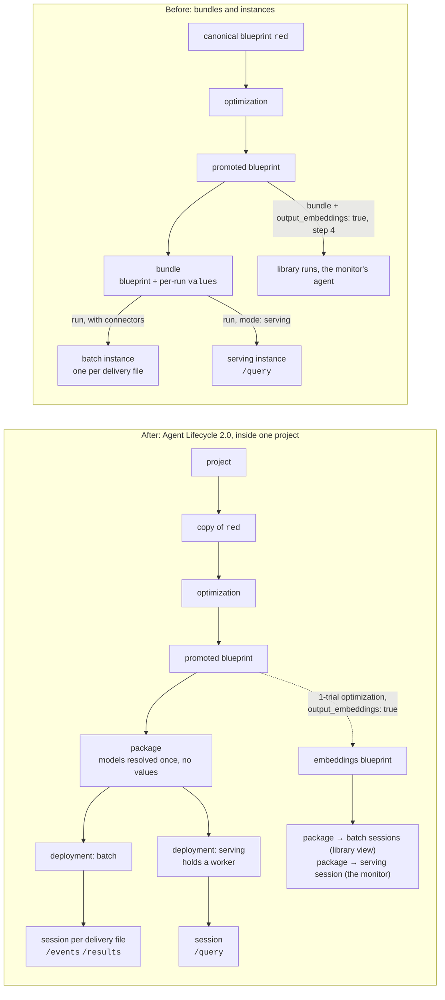
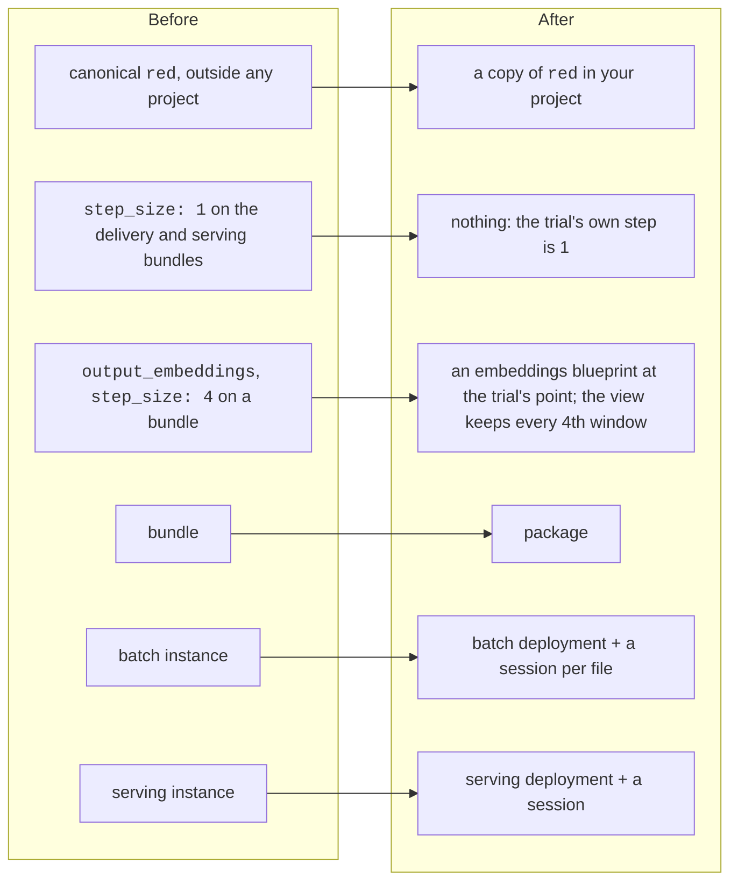

# Migrating to Agent Lifecycle 2.0

How this quickstart moved from bundles and instances to **projects, packages,
deployments and sessions**, and what to watch for if you move your own scripts.
Stages 4–9 and the live monitor were run end to end on 2026-10-31. That run used an
org-admin key, but the scripts make no admin-only call (see 6 below); a run with a
member key is still to be confirmed.

`/api/agents/bundles` and `/api/agents/instances` are being retired: move to the calls
below. To check that your deployment of the platform serves them, `GET
{root}/api/agents/sessions?limit=1` should answer 200, not 404.

## Before and after

- **Project:** where everything lives. Every object takes its project from the one it
  was made from: an optimization from its blueprint, a promoted blueprint from its
  optimization, a package from its blueprint, a deployment from its package, a session
  from its deployment.
- **Package:** one blueprint, target `platform`, with its models resolved when it is
  built (the Omega encoder `mdl_…`, the fitted prototypes `aar_…`). It has **no values**.
- **Deployment:** the package placed to run. `batch` is ready at once; `serving` places
  and loads the agent on a worker, usually within seconds, and holds that worker until
  it is stopped.
- **Session:** a run on a deployment. On `batch`, one run over its input files. On
  `serving`, a client's handle on the loaded agent, answering `/query` once it is
  `running` and staying open until it is cancelled or the deployment ends. Several
  sessions can share one serving deployment.

## What moved where

| Before | After | Why it changed |
|---|---|---|
| canonical `red`, outside any project | a copy of `red` in your project (`red-pump`) | a deployment needs a project, and everything takes its project from the blueprint it starts from |
| `step_size: 1` on the delivery and serving bundles | nothing | a package has no values; the trial already runs at step 1, so it was never a change |
| `output_embeddings: true` and `step_size: 4` on the library bundle and the monitor's | an embeddings blueprint, at the trial's step 1 | an output can't be switched on per run any more, nor the step changed |
| bundle | package | its models are resolved once, at build time |
| instance (batch) | batch deployment + a session per file | the deployment is set up once; each run is a session |
| instance (serving) | serving deployment + a session | the deployment holds the loaded agent; sessions are clients of it |
| `/logs` | session `status`, `error`, `/events` | a session reaches a terminal status and says why |

## Old calls, new calls

All paths are under `{root}/api/agents` unless shown otherwise.

| Before | After |
|---|---|
| — | `POST {root}/api/projects` `{name, description}` |
| optimize the canonical `red` | `POST /blueprints/red/copy` `{project_id, blueprint_key}`, then optimize the copy |
| `POST /bundles` `{blueprint, values}` | `POST /packages` `{blueprint_ids: [blp_…], target: {kind: "platform"}, name}`; poll until `ready` |
| `POST /bundles/{id}/run` `{connectors}` | `POST /deployments` `{package_id, kind: "batch"}`, then `POST /sessions` `{deployment_id, connectors: {source: [...]}}` |
| `POST /bundles/{id}/run` `{mode: "serving"}` | `POST /deployments` `{package_id, kind: "serving"}`; poll until `ready`; `POST /sessions` `{deployment_id}`; poll until `running` |
| `GET /instances/{id}` | `GET /sessions/{id}` (`status`, `error`, `job_id`) |
| `GET /instances/{id}/events`, `/logs` | `GET /sessions/{id}/events` (newest first; there is no `/logs`) |
| `GET /instances/{id}/results` | `GET /sessions/{id}/results` |
| `POST /instances/{id}/query` | `POST /sessions/{id}/query` (same body, same `response`) |
| `POST /instances/{id}/cancel`, `DELETE /instances/{id}` | `POST /sessions/{id}/cancel`, `DELETE /sessions/{id}` |
| `DELETE /bundles/{id}` | `POST /deployments/{id}/stop`, `DELETE /deployments/{id}`, then `DELETE /packages/{id}` |
| `GET /instances?bundle_id=` | `GET /deployments?package_id=`, `GET /sessions?deployment_id=` |

Statuses: package `building → ready | failed`; deployment `deploying → ready → stopping →
stopped | failed`; session `pending → running → completed | failed | cancelled` (and
`paused`).

## What changed in practice

1. **Get into a project by copying `red`.** A deployment needs its package in a project,
   and a package lands in its blueprint's project. The canonical `red` is outside any
   project, and `POST /optimizations` takes no `project_id`, so Stage 4 copies `red` into
   the project first and optimizes the copy (`fit/atai.py`, `base_blueprint()`). An
   existing project of that name, and an existing copy under `red-pump`, are reused.
   With the copy keyed `red-pump`, the platform's default key for a promoted trial,
   `red-pump-<trial id>`, is the one `fit/test.py` chooses.

2. **Nothing to pin that wasn't already.** The bundles added `step_size: 1`, which was
   the trial's own step, and Stage 4 already pinned `data_columns`, `timestamp_column`,
   `events` and `background`. So the package of the promoted blueprint delivers and
   serves exactly as the bundles did: the delivery outputs came out byte-identical.

3. **Embeddings need their own blueprint.** The library view and the monitor's live
   point need each window's embeddings, which an agent returns only with
   `output_embeddings: true`. `fit/library_embeddings.py` now makes an embeddings
   blueprint: a 1-trial optimization at Stage 5's trial's point (window 64, step 1,
   `dot`) with the switch pinned, then promoted. Its prototypes are the class means of
   the same windows, so it answers as Stage 5's blueprint; the monitor's bridge serves
   it, when it was made from the current Stage 5 blueprint.

4. **The library view keeps every 4th window itself.** The bundle ran the library at
   `step_size: 4`; a package can't change the step, so the sessions run at step 1 and
   the script keeps every 4th window: the same 3,016 windows, at about 4 times the
   download (about 1 GB for the three files). The view came out the same, to within its
   rounding.

5. **Status is reliable, and `error` says why.** A session reaches a terminal status and
   carries `error`; `red_api.poll_session` follows `status` and prints `/events`.

6. **No admin-only calls.** Two calls that would need the org-admin role are avoided or
   have a fallback:
   - `POST /blueprints` (registering an edited copy of a promoted blueprint, e.g. with
     embeddings on) takes the admin role; the 1-trial optimization doesn't;
   - choosing `blueprint_key` on promote takes it too: `fit/test.py` tries its own key and,
     on a 403, lets the platform choose, which here is the same key.

7. **A session's result `ref` is a root path.** `/sessions/{id}/results` returns
   `ref: "/api/files/<fil_…>/content"`, which already includes `/api`: resolve it against
   the deployment root (`red_api.py`, `download_results`).

8. **Cleanup goes session, deployment, package.** Each holds the next. Cancel a session
   that is still going and stop a deployment that is still up before deleting them.
   `fit/cleanup.py` starts from each recorded package and lists its deployments and their
   sessions, so ones a script never recorded are found too. It keeps the embeddings
   blueprint's id in `fit/out/library_state.json`, for a rerun and for the monitor.

9. **A resumed delivery collects, it doesn't restart.** The session ids are in
   `fit/out/deliver_state.json` as soon as they exist: stopped mid-delivery (Ctrl-C), a
   rerun found one session already completed on the platform and only downloaded its
   output.

## This repo, file by file

| File | Change |
|---|---|
| `red_api.py` | `create_package`, `deploy`, `open_session`, `wait_running`, `poll_session`, `end`, `list_ids`; results from sessions, their ref resolved against the root; the bundle and instance helpers removed |
| `fit/atai.py` | `base_blueprint()`: the project `RED pump quickstart` and its copy of `red` (`fit/out/project_state.json`) |
| `fit/optimize.py` | optimize the project's copy |
| `fit/test.py` | promote takes an optional name (for the embeddings blueprint) |
| `fit/deliver.py` | a package, one batch deployment, a session per file |
| `fit/serve.py` | a serving deployment and one session; all three deleted on exit |
| `fit/library_embeddings.py` | the embeddings blueprint, then a package, a batch deployment and a session per training file; every `--step`-th window kept |
| `app-serving/scripts/serving-bridge.js` | the embeddings blueprint, packaged, deployed for serving, a session; a session that stops taking queries is replaced, with a new deployment if the old one is gone |
| `fit/cleanup.py` | sessions, deployments, packages, found from each package |

## Results against the bundle version

| Stage | Measure | Bundles (production, 2026-10-28/29) | Packages and sessions (dev, 2026-10-31) |
|---|---|---|---|
| 4 | fault F1, `dot` / `cosine` / `l2` / `l1` | 0.8588 / 0.8474 / 0.8400 / 0.8325 | the same, with the same confusion matrices |
| 5 | test fault F1 (whole-window); false alarms; breakdowns | 0.9697; 369 / 28,256; +54, +0, missed, +60 | the same, with the same confusion counts |
| 6–7 | delivery fault F1; false alarms; breakdowns | 0.9013; 45 / 3,844; +54, +60 | byte-identical outputs and evaluation; two sessions, about a minute each |
| 8 | served against batch, 1,162 windows | every state and probability identical; 436 ms median | the same; 352 ms median |
| 9 | library view; the monitor | 3,016 windows, PC1+PC2 32.5% + 4.0% | the same, to within its rounding; the monitor runs on the embeddings blueprint |

## Moving your own scripts

1. Create a project, or reuse yours, and copy the blueprint you start from into it.
2. Move every per-run `values` override into the optimization's `overrides`, or into a
   separate promoted blueprint if only some runs need it. If you subsampled with a
   coarser step, run at the blueprint's step and subsample the output yourself.
3. Replace `bundles` with a package (poll until `ready`), and each run with a session on
   a `batch` or `serving` deployment.
4. Read `/sessions/{id}/events` and `/results`, and resolve result refs against the root,
   not against `…/api`.
5. Clean up sessions, then deployments, then packages; stop serving deployments when
   you're done, since each holds a worker.
